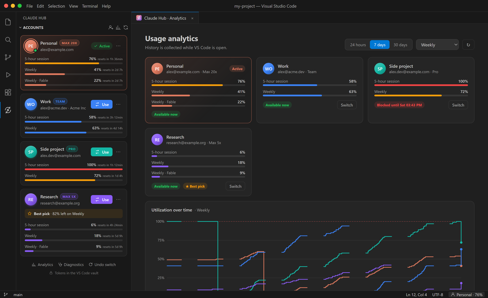
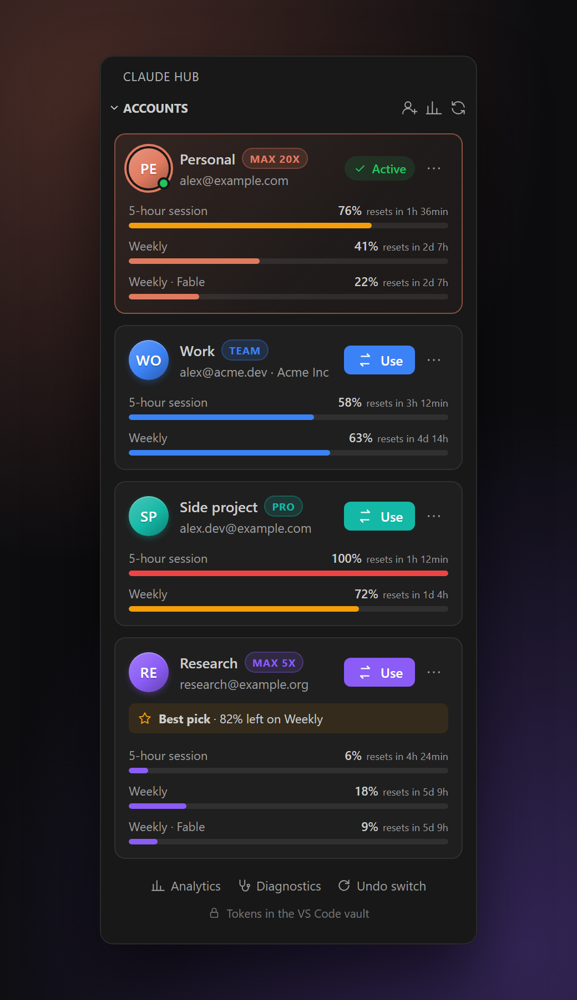
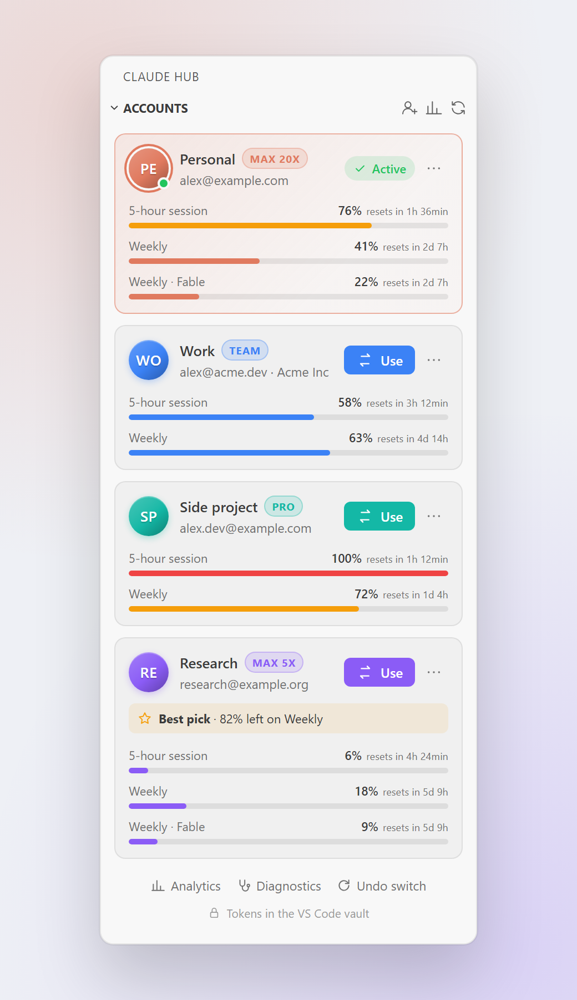
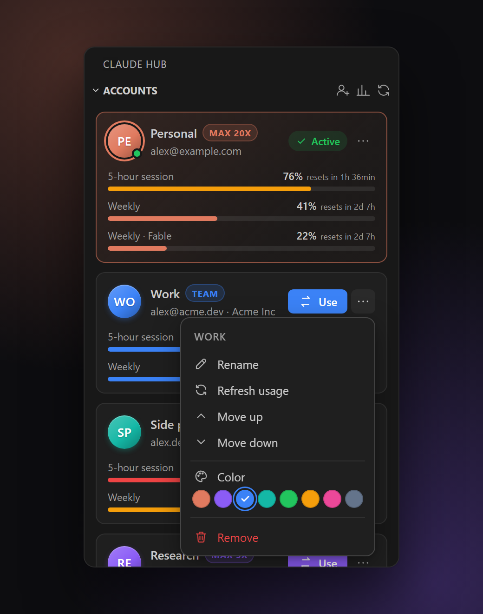
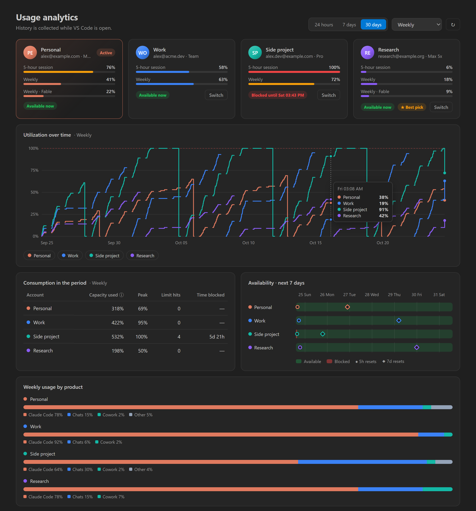
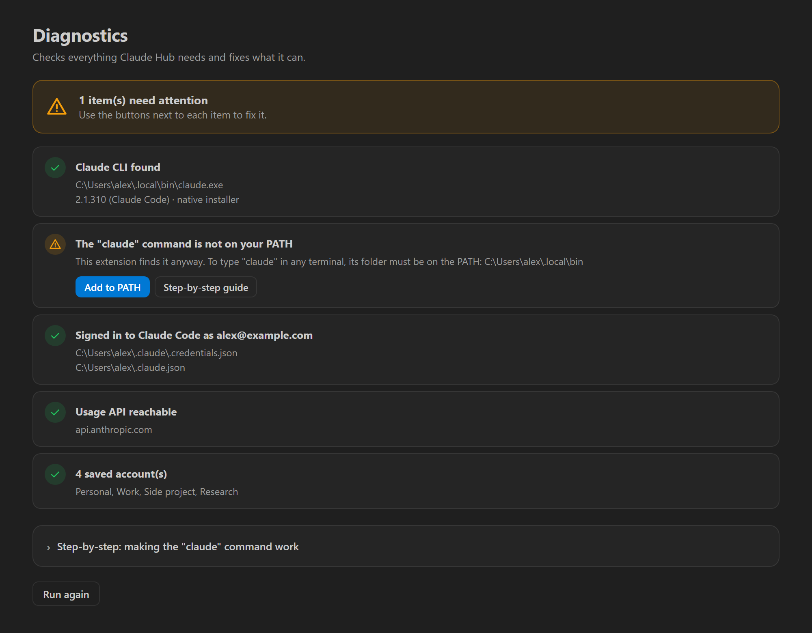

# Claude Hub

**English** · [Português](README.pt-BR.md)

Switch between Claude Code accounts in VS Code with one click — no signing out and back in.



- **Accounts panel** in the sidebar: one card per account with color, plan (Pro / Max) and every usage limit — 5-hour session, weekly, and per-model limits such as **Fable** or Opus.
- **Status bar** with the active account and its 5-hour usage (turns yellow/red near the limit). Click to switch.
- **Usage analytics**: usage over time per account, consumption per period, limit hits, time blocked, availability for the next 7 days, and weekly usage by product.
- **Notifications** when a used-up limit is available again, and when the active account runs low — with a one-click switch to the best alternative.
- **Suggest the best account**, in general or for a specific model limit (e.g. Fable).
- **Isolated sign-in** for new accounts: the login happens in a temporary folder, the current account is never touched.
- **Diagnostics** that check everything and fix problems in one click (CLI not found, PATH, conflicts, expired logins).
- **English and Portuguese** (follows the VS Code display language).
- **No runtime dependencies**, no telemetry, no ads. Network access only to `api.anthropic.com` (usage) and `platform.claude.com` (token renewal) — both can be turned off.

## Screenshots

| Accounts | Light theme | Card menu |
| :---: | :---: | :---: |
|  |  |  |

**Usage analytics** — usage over time, consumption, availability and usage by product:



**Diagnostics** — checks everything and fixes problems in one click:



<sub>Screenshots use made-up accounts. Regenerate them with `npm run screenshots`.</sub>

## How it works

Claude Code keeps its login in two places:

| File | Key | Content |
| --- | --- | --- |
| `~/.claude/.credentials.json` | `claudeAiOauth`, `organizationUuid` | OAuth tokens |
| `~/.claude.json` | `oauthAccount` | email, name, organization |

Switching means writing the saved data of another account into those keys. Everything else (plugin MCP tokens, projects, settings) stays untouched. Writes are atomic (temp file + rename).

Saved logins live in the VS Code **SecretStorage**, encrypted by the operating system (Credential Manager on Windows, Keychain on macOS, libsecret on Linux) — never in plain text.

While an account is active, the extension follows Claude Code's files and keeps the tokens it renews, so the saved copy never goes stale. Accounts that are **not** active get their access token renewed by the extension (only those — the active one always belongs to Claude Code), so their usage stays visible. Turn this off with `claudeHub.refreshInactiveTokens`.

## Getting started

1. Open the **Claude Hub** panel in the activity bar.
2. Click **Save** to store the account already signed in.
3. Click **Add account** (person icon at the top of the panel). A terminal runs `claude auth login`; sign in with the other account in the browser (if the browser is signed in to the current account, switch there before authorizing).
4. Use the **Use** button on any card and reload the window.

> ⚠️ **Never use `/logout` to switch accounts**: it revokes the token on the server and the saved login stops working.

> With **several VS Code windows** open, reload all of them after switching. An old window may keep using the previous account.

## Troubleshooting

Run **Claude Hub: Run diagnostics** (Command Palette, or the panel's `…` menu). It checks the CLI, the PATH, your login, the usage API and conflicting extensions, and offers a button to fix each problem. The step-by-step guide below is also inside it.

### "claude" is not recognized / the CLI is not found

The extension does **not** need `claude` on the PATH: it looks in the PATH stored in the registry (so a CLI installed after VS Code started is found), in the native installer folder (`~/.local/bin`), in the npm global folder and in the binary bundled with the Claude Code extension. If you still want the `claude` command in your terminals:

**Windows**

1. **Check** — open a *new* PowerShell and run `claude --version`. A version means it is fine.
2. **Install** — if it is missing: `irm https://claude.ai/install.ps1 | iex`
3. **Find the folder** — `Test-Path "$env:USERPROFILE\.local\bin\claude.exe"` should print `True`.
4. **Add to PATH** — use the *Add to PATH* button in Diagnostics, or:
   ```powershell
   [Environment]::SetEnvironmentVariable('Path', [Environment]::GetEnvironmentVariable('Path','User') + ';' + "$env:USERPROFILE\.local\bin", 'User')
   ```
   Manually: `Win+R` → `sysdm.cpl` → *Advanced* → *Environment Variables* → *User variables* → `Path` → *Edit* → *New* → `%USERPROFILE%\.local\bin` → OK.
5. **Restart** — close **all** VS Code windows and open it again (programs read the PATH only when they start).
6. **Verify** — `where.exe claude`

**macOS / Linux**

1. `claude --version`
2. Install: `curl -fsSL https://claude.ai/install.sh | bash`
3. If still not found: `echo 'export PATH="$HOME/.local/bin:$PATH"' >> ~/.zshrc` (or `~/.bashrc`)
4. Reopen VS Code and the terminals, then `which claude`

You can also point to the executable with the `claudeHub.cliPath` setting, or *Locate executable…* in Diagnostics.

### Other problems

| Symptom | Fix |
| --- | --- |
| Switched, but Claude Code still uses the old account | Reload the window (all windows, if several are open). |
| "Login expired — add this account again" | The saved refresh token was rejected (e.g. `/logout` was used). Add the account again. |
| Usage shows "Too many requests" | The usage API rate-limited the requests; it backs off for 5 minutes on its own. |
| Accounts get mixed up | Another account switcher is installed and writes the same files. Keep only one enabled (Diagnostics shows it). |
| A limit does not show (e.g. Fable) | Model limits only appear for plans that have them. Refresh the usage. |

## Settings

| Setting | Default | Description |
| --- | --- | --- |
| `claudeHub.afterSwitch` | `ask` | `ask`, `reload` or `nothing` after switching |
| `claudeHub.showUsage` | `true` | Fetch and show usage limits |
| `claudeHub.usageRefreshMinutes` | `5` | How often usage is refreshed |
| `claudeHub.refreshInactiveTokens` | `true` | Renew tokens of inactive accounts to keep their usage current |
| `claudeHub.warnAtPercent` | `90` | Warn when the active account reaches this % of a limit (0 = off) |
| `claudeHub.notifyWhenAvailable` | `true` | Notify when a used-up limit is available again |
| `claudeHub.statusBar` | `true` | Show the account in the status bar |
| `claudeHub.cliPath` | empty | Path of `claude`. Empty = automatic detection |

## Development

```bash
npm install
npm run compile      # builds into out/
npm run check-l10n   # every string translated?
npm run package      # creates claude-switch-x.y.z.vsix
code --install-extension claude-hub-accounts-1.1.0.vsix
```

Press `F5` in VS Code to open a test window with the extension.

Translations: UI strings use `vscode.l10n.t('English text')`; Portuguese lives in `l10n/bundle.l10n.pt-br.json` and `package.nls.pt-br.json`. To add a language, run `node scripts/check-l10n.js --keys > l10n/bundle.l10n.<lang>.json` and translate the values.

The icon is generated by `npm run icon` (dependency-free script in `scripts/make-icon.js`).

Screenshots are generated by `npm run screenshots`: the real webview code fed with made-up data (`scripts/screenshots/fake-data.js`), rendered by headless Chrome or Edge (set `CHROME_PATH` if neither is found).
