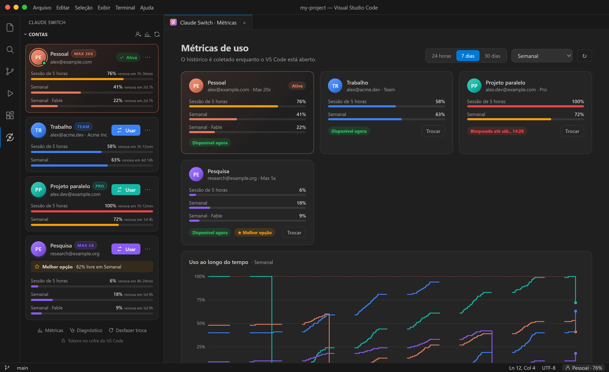
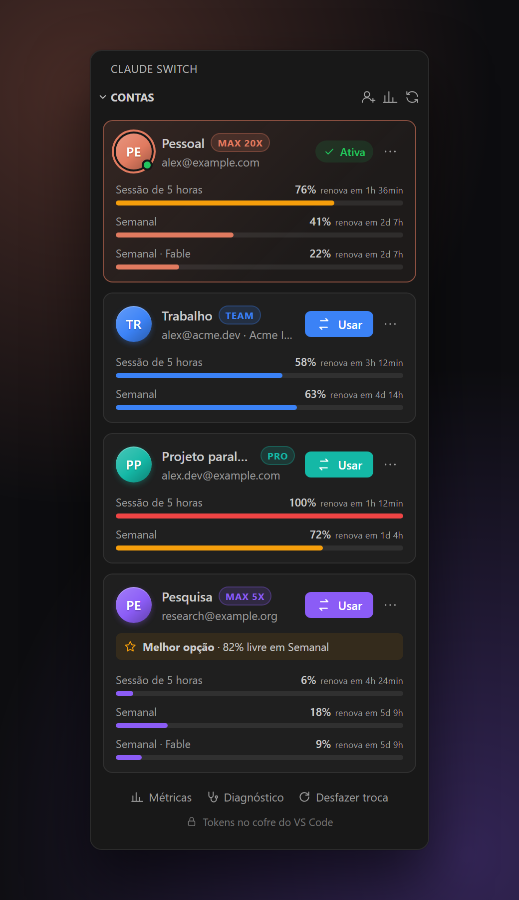
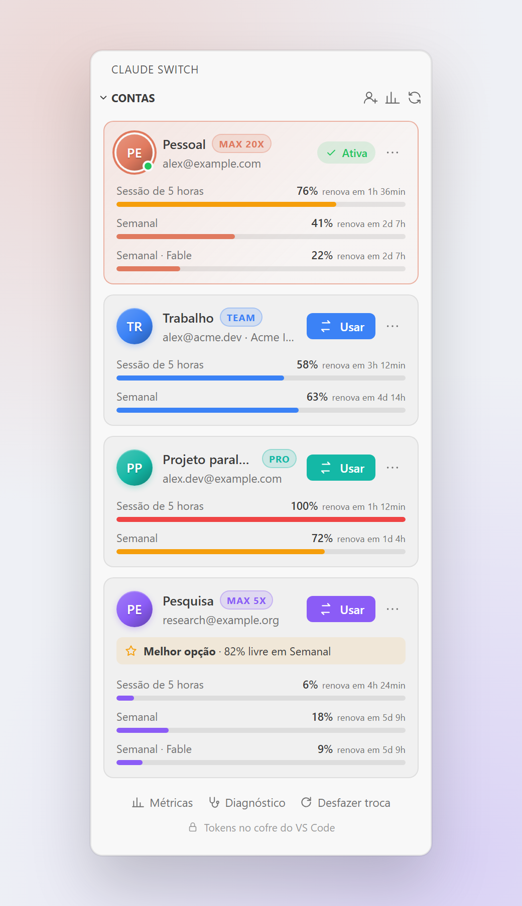
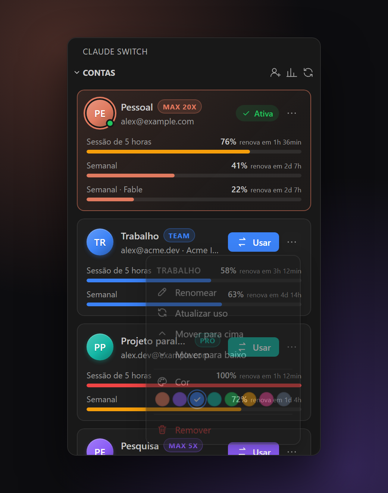
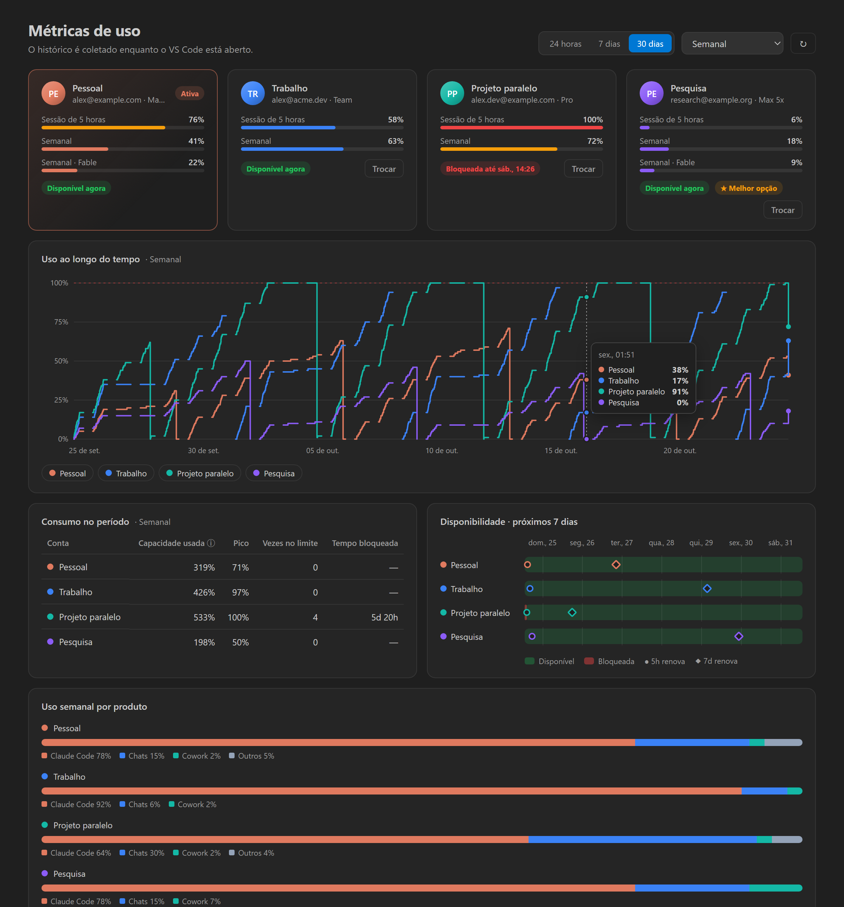
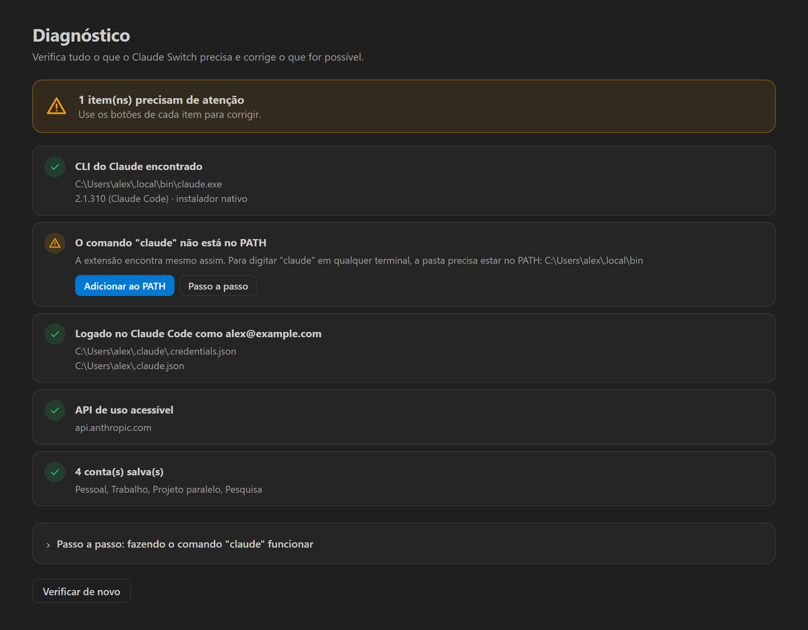

# Claude Switch

[English](README.md) · **Português**

Troque entre contas do Claude Code no VS Code com um clique, sem sair e entrar de novo.



- **Painel de contas** na barra lateral: um cartão por conta com cor, plano (Pro / Max) e todos os limites de uso — sessão de 5 horas, semanal e limites por modelo, como **Fable** ou Opus.
- **Barra de status** com a conta ativa e o uso de 5 horas (fica amarela/vermelha perto do limite). Clique para trocar.
- **Métricas de uso**: uso ao longo do tempo por conta, consumo no período, vezes no limite, tempo bloqueada, disponibilidade nos próximos 7 dias e uso semanal por produto.
- **Notificações** quando um limite esgotado volta a ficar disponível e quando a conta ativa está acabando — com troca em um clique para a melhor alternativa.
- **Sugestão da melhor conta**, em geral ou para um limite de modelo (ex.: Fable).
- **Login isolado** de novas contas: o login acontece numa pasta temporária, a conta atual nunca é tocada.
- **Diagnóstico** que verifica tudo e corrige problemas com um clique (CLI não encontrado, PATH, conflitos, logins expirados).
- **Inglês e português** (segue o idioma do VS Code).
- **Sem dependências em runtime**, sem telemetria, sem propaganda. Acesso à rede só para `api.anthropic.com` (uso) e `platform.claude.com` (renovação de token) — os dois podem ser desligados.

## Screenshots

| Contas | Tema claro | Menu do card |
| :---: | :---: | :---: |
|  |  |  |

**Métricas de uso** — uso ao longo do tempo, consumo, disponibilidade e uso por produto:



**Diagnóstico** — verifica tudo e corrige problemas com um clique:



<sub>As screenshots usam contas fictícias. Gere de novo com `npm run screenshots`.</sub>

## Como funciona

O Claude Code guarda o login em dois lugares:

| Arquivo | Chave | Conteúdo |
| --- | --- | --- |
| `~/.claude/.credentials.json` | `claudeAiOauth`, `organizationUuid` | tokens OAuth |
| `~/.claude.json` | `oauthAccount` | e-mail, nome, organização |

Trocar de conta = gravar nessas chaves os dados salvos da outra conta. Todo o resto (tokens MCP dos plugins, projetos, configurações) fica intacto. As gravações são atômicas (arquivo temporário + rename).

Os logins salvos ficam no **SecretStorage** do VS Code, criptografado pelo sistema (Credential Manager no Windows, Keychain no macOS, libsecret no Linux) — nunca em texto puro.

Enquanto uma conta está ativa, a extensão acompanha os arquivos do Claude Code e guarda os tokens renovados, para a cópia salva nunca ficar desatualizada. As contas **inativas** têm o token renovado pela extensão (só elas — a ativa é sempre do Claude Code), para o uso delas continuar visível. Dá para desligar em `claudeSwitch.refreshInactiveTokens`.

## Primeiros passos

1. Abra o painel **Claude Switch** na barra lateral.
2. Clique em **Salvar** para guardar a conta já logada.
3. Clique em **Adicionar conta** (ícone de pessoa no topo do painel). Um terminal roda `claude auth login`; entre com a outra conta no navegador (se o navegador estiver logado na conta atual, troque lá antes de autorizar).
4. Use o botão **Usar** em qualquer cartão e recarregue a janela.

> ⚠️ **Nunca use `/logout` para trocar de conta**: isso revoga o token no servidor e o login salvo para de funcionar.

> Com **várias janelas do VS Code** abertas, recarregue todas depois de trocar. Uma janela antiga pode continuar usando a conta anterior.

## Solução de problemas

Rode **Claude Switch: Executar diagnóstico** (Paleta de Comandos, ou o menu `…` do painel). Ele verifica o CLI, o PATH, o login, a API de uso e extensões conflitantes, e oferece um botão para corrigir cada problema. O passo a passo abaixo também está lá dentro.

### "claude não é reconhecido" / CLI não encontrado

A extensão **não** precisa do `claude` no PATH: ela procura no PATH gravado no registro (então um CLI instalado depois de abrir o VS Code é encontrado), na pasta do instalador nativo (`~/.local/bin`), na pasta global do npm e no binário que vem com a extensão do Claude Code. Se você também quiser o comando `claude` nos terminais:

**Windows**

1. **Verificar** — abra um PowerShell *novo* e rode `claude --version`. Se aparecer uma versão, está tudo certo.
2. **Instalar** — se não tiver: `irm https://claude.ai/install.ps1 | iex`
3. **Encontrar a pasta** — `Test-Path "$env:USERPROFILE\.local\bin\claude.exe"` deve mostrar `True`.
4. **Adicionar ao PATH** — use o botão *Adicionar ao PATH* no Diagnóstico, ou:
   ```powershell
   [Environment]::SetEnvironmentVariable('Path', [Environment]::GetEnvironmentVariable('Path','User') + ';' + "$env:USERPROFILE\.local\bin", 'User')
   ```
   Manualmente: `Win+R` → `sysdm.cpl` → *Avançado* → *Variáveis de Ambiente* → *Variáveis de usuário* → `Path` → *Editar* → *Novo* → `%USERPROFILE%\.local\bin` → OK.
5. **Reiniciar** — feche **todas** as janelas do VS Code e abra de novo (os programas só leem o PATH quando iniciam).
6. **Conferir** — `where.exe claude`

**macOS / Linux**

1. `claude --version`
2. Instalar: `curl -fsSL https://claude.ai/install.sh | bash`
3. Se ainda não achar: `echo 'export PATH="$HOME/.local/bin:$PATH"' >> ~/.zshrc` (ou `~/.bashrc`)
4. Abra de novo o VS Code e os terminais, depois `which claude`

Também dá para indicar o executável na configuração `claudeSwitch.cliPath`, ou em *Localizar executável…* no Diagnóstico.

### Outros problemas

| Sintoma | Solução |
| --- | --- |
| Troquei, mas o Claude Code continua na conta antiga | Recarregue a janela (todas, se houver várias abertas). |
| "Login expirado — adicione esta conta de novo" | O refresh token salvo foi recusado (ex.: alguém usou `/logout`). Adicione a conta de novo. |
| O uso mostra "Muitas requisições" | A API limitou as consultas; a extensão espera 5 minutos sozinha. |
| As contas se misturam | Outro gerenciador de contas está instalado e grava os mesmos arquivos. Deixe só um ativado (o Diagnóstico mostra). |
| Um limite não aparece (ex.: Fable) | Limites por modelo só aparecem nos planos que os têm. Atualize o uso. |

## Configurações

| Configuração | Padrão | Descrição |
| --- | --- | --- |
| `claudeSwitch.afterSwitch` | `ask` | `ask`, `reload` ou `nothing` depois de trocar |
| `claudeSwitch.showUsage` | `true` | Consultar e mostrar os limites de uso |
| `claudeSwitch.usageRefreshMinutes` | `5` | Intervalo de atualização do uso |
| `claudeSwitch.refreshInactiveTokens` | `true` | Renovar tokens das contas inativas para manter o uso atualizado |
| `claudeSwitch.warnAtPercent` | `90` | Avisar quando a conta ativa atingir esta % de um limite (0 = desligado) |
| `claudeSwitch.notifyWhenAvailable` | `true` | Avisar quando um limite esgotado voltar a ficar disponível |
| `claudeSwitch.statusBar` | `true` | Mostrar a conta na barra de status |
| `claudeSwitch.cliPath` | vazio | Caminho do `claude`. Vazio = detecção automática |

## Desenvolvimento

Veja a seção *Development* do [README em inglês](README.md#development).
